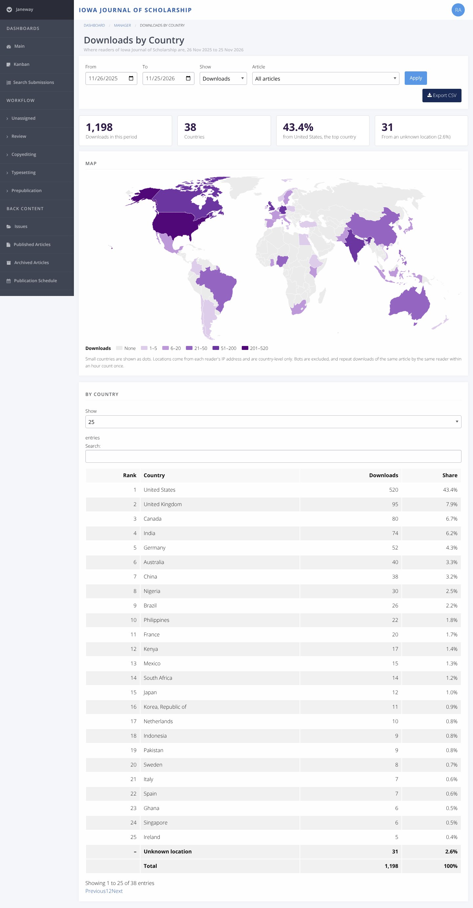

# Downloads by Country

A Janeway plugin by Rod Library that shows where an article's readers are. It draws a world map shaded by downloads (or views) per country, with headline figures, a sortable table and a CSV export.



## Who can see it

- **Editors and Journal Managers** see their own journal at `/<journal>/plugins/downloads-by-country/`, linked as **Downloads by Country** in the back-office menu.
- **Staff** can also open it at press level (`/plugins/downloads-by-country/`) to see every journal together, or pick one journal.

## Filters

| Filter | What it does |
|---|---|
| From / To | Date range; defaults to the last 12 months |
| Show | Downloads (default) or Views |
| Article | One published article, or all (journal level) |
| Journal | One journal, or all (press level, staff only) |

**Export CSV** downloads the table for the current filters, including the unknown-location count and the total.

## Where the numbers come from

Janeway records a country for every article view and download, worked out from the reader's IP address using the MaxMind GeoLite2 country database that ships with Janeway. The plugin only reads those records; it adds no tracking and stores nothing new.

- Locations are country-level only. IP addresses aren't stored.
- Bots are excluded, and the same reader opening the same article again within an hour counts once.
- Only published articles are included.
- **Unknown location** counts accesses whose country couldn't be identified, such as local network addresses.
- Accesses imported from before Janeway recorded countries (historic totals) aren't included.

## Install

The plugin lives in `src/plugins/downloads_by_country/`. Run this once on each server, then restart Janeway:

```bash
python3 src/manage.py install_plugins
```

## Tests

```bash
python3 src/manage.py test plugins.downloads_by_country.tests.test_downloads_by_country
```

## The map

Country shapes are in `data/world_map.json`, built from Natural Earth (public domain) at 1:110m. Countries too small to draw at that scale, such as Singapore and Malta, appear as dots using 1:50m data. To rebuild the file, see `tools/build_world_map.mjs`.

Shades run from light lavender (few) to UNI Panther Purple (most), with grey for none. The breaks are spaced on a log scale, because one or two countries usually dominate and a straight scale would leave everyone else in the palest shade.
